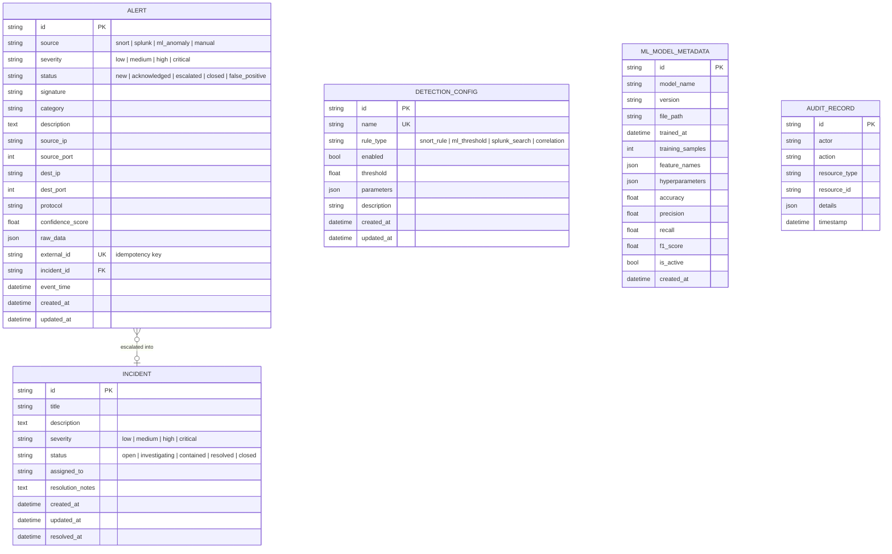

# Data Model

Five SQLAlchemy 2.x ORM tables (`backend/app/models/`), managed by
Alembic migrations (`backend/alembic/`). Database-agnostic: SQLite in the
lab default, any SQLAlchemy-supported URL (e.g. PostgreSQL) via
`DATABASE_URL`.



`DetectionConfig`, `MLModelMetadata`, and `AuditRecord` have no foreign
keys to `Alert`/`Incident` — they're referenced by name/ID inside JSON
`details`/`parameters` rather than a relational FK, since an audit
record or a model version can point at a resource that's since been
deleted and the reference is a point-in-time fact, not a live join.

## Alert

The unit of detection, from any of four sources.

- **`source`** (`AlertSource`): `snort`, `splunk`, `ml_anomaly`,
  `manual`. `ml_anomaly` alerts are synthetic — created by
  `ml_service.score_and_create_anomaly_alerts` from existing alert
  history, not from raw sensor traffic — but otherwise identical
  citizens of this table.
- **`severity`** (`AlertSeverity`): `low | medium | high | critical`.
- **`status`** (`AlertStatus`): `new` (default) → `acknowledged` →
  `escalated` (set automatically when the correlation engine or a manual
  `POST /incidents` with `alert_ids` attaches it to an incident) → a
  terminal state of `closed` or `false_positive`.
- **`external_id`**: a unique, source-specific idempotency key (e.g.
  Snort's gid/sid/rev/timestamp, or a Splunk result's `_cd`-derived
  value). `get_or_create_alert()` looks this up before inserting, so
  re-running a sync is always safe.
- **`raw_data`**: the original sensor payload (JSON), kept for forensic
  reference even though the structured columns above are extracted from
  it. For Snort, `event_time` is stringified within `raw_data` (a plain
  JSON column can't serialize a `datetime`) while the dedicated
  `event_time` column keeps the real `datetime`.
- Indexes: `(source, severity)` and `created_at`, matching the dashboard's
  two most common filter/sort patterns.

## Incident

A grouping of one or more related alerts an analyst tracks as a single
security event, through triage to resolution.

- **`status`** (`IncidentStatus`): `open` (default) → `investigating` →
  `contained` → `resolved` | `closed`. `resolved_at` is stamped
  automatically the moment `status` transitions to `resolved` or
  `closed` via `PATCH /api/v1/incidents/{id}`.
- **`alerts`**: one-to-many back-reference from `Alert.incident_id`.

## DetectionConfig

A tunable detection rule/threshold, independent of which engine
evaluates it (`rule_type`). One row is seeded automatically at startup —
`source_ip_burst` (`rule_type=correlation`) — by
`correlation.ensure_default_detection_configs()`, with its initial
`enabled`/`threshold`/`parameters.window_seconds` taken from `Settings`
(`AUTO_CORRELATE_ENABLED`, `CORRELATION_DEFAULT_THRESHOLD`,
`CORRELATION_DEFAULT_WINDOW_SECONDS`). After that first run, the database
row is the live source of truth — editing it via `PATCH
/api/v1/detection-configs/{id}` takes effect on the next correlation pass
with no restart needed; the `Settings` values only matter if the row is
ever deleted.

## MLModelMetadata

A registry entry for one trained `IsolationForest` artifact. Training
writes the fitted model + its feature column order to a joblib file
under `ML_MODEL_DIR` and a matching row here; scoring loads whichever row
has `is_active=true` for `model_name` (training always deactivates the
previous active row for the same name, so exactly one is active at a
time, enabling instant "rollback" by reactivating an older row directly
in the database if ever needed).

`f1_score`, `accuracy`, `precision`, and `recall` remain `null` until a
labeled, held-out evaluation has been run; the bundled lab traffic has no
ground-truth labels. Isolation Forest `decision_function` outputs are
anomaly scores, not probabilities. Artifacts are loaded only from the
configured model directory and their feature schema is checked before
scoring.

## AuditRecord

An append-only log of who changed what. Alert/incident state changes,
user administration, detection-config changes, and correlation-created
incidents are recorded. Triage entries include the authenticated actor,
resource, changed fields, and optional note. Audit records can be listed
through the admin-only `GET /api/v1/audit` endpoint.

## Migrations

Schema changes go through Alembic (`backend/alembic/`):

```bash
cd backend && source .venv/bin/activate
alembic revision --autogenerate -m "describe the change"
alembic upgrade head
```

`scripts/setup.sh` runs `alembic upgrade head` as part of first-time
setup; the test suite builds its schema directly from the ORM metadata
(`Base.metadata.create_all`) rather than running migrations, so a
migration and a model change must be kept in sync by hand — the tests
won't catch drift between them.
