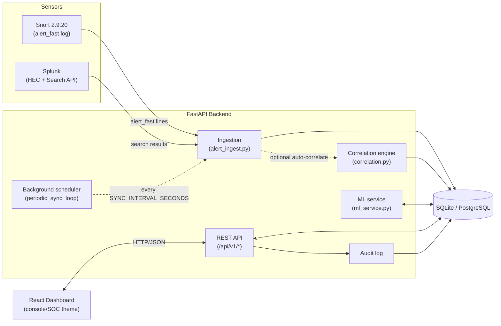
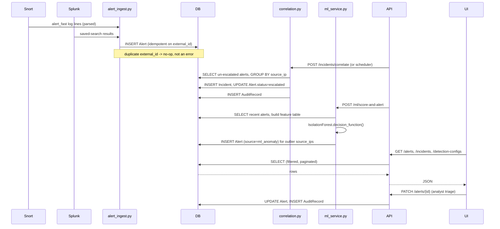

# Architecture

This document describes the SIEM Threat Detection Platform's system
architecture, process flow, and the design decisions behind them. It
corresponds to the "Tech Stack," "System/Process Architecture," and
"High-Level Data Flow" diagrams in the original product specification.

## 1. Tech stack

| Layer | Technology | Role |
|---|---|---|
| Network IDS | Snort 2.9.20 | Signature-based detection on raw/replayed traffic, writes `alert_fast` log lines |
| SIEM | Splunk (HEC + REST Search API) | Log aggregation, saved searches, event storage |
| Backend | Python 3.13, FastAPI, SQLAlchemy 2.x, Alembic, Pydantic v2 | Ingestion, correlation, triage API, ML serving |
| Database | SQLite (dev) / PostgreSQL (prod-compatible) | System of record for alerts, incidents, configs, audit trail |
| ML | scikit-learn `IsolationForest`, pandas, numpy, joblib | Unsupervised anomaly detection over alert features |
| Frontend | React 18, TypeScript, Tailwind CSS, Vite 6 | Console/SOC-themed analyst dashboard |
| Testing | pytest, pytest-cov, respx (backend); Vitest, React Testing Library, jsdom (frontend) | 113 backend tests @ 100% line coverage, 23 frontend tests |
| Orchestration | Docker, Docker Compose, Makefile | Local multi-service stack |

## 2. System architecture

Everything downstream of ingestion — correlation, scoring, triage — is
driven through the same FastAPI app and the same `Alert`/`Incident`
tables, so the dashboard, a script, and the background scheduler are all
just callers of the same services.

## 3. Process architecture

Three ways work enters the system, all converging on the same ingestion
helper:

1. **Manual trigger** — an analyst (or a script) calls `POST
   /api/v1/snort/sync` or `POST /api/v1/splunk/sync` directly.
2. **Background scheduler** — if `AUTO_SYNC_ENABLED=true`, a single
   asyncio task (`app.scheduler.periodic_sync_loop`) started in the
   FastAPI `lifespan` runs both syncs (and, if `AUTO_CORRELATE_ENABLED`,
   correlation) every `SYNC_INTERVAL_SECONDS`, until the app shuts down.
3. **Dashboard** — the React app calls the same endpoints a script would;
   there is no separate dashboard-only code path.

Within a single sync or correlation pass, there is no concurrency to
reason about: each call holds one SQLAlchemy `Session`, does its work
transactionally, and commits once. The scheduler loop awaits one full
cycle before sleeping and starting the next, so overlapping runs can't
happen even if a cycle runs long.

## 4. High-level data flow

### Idempotency

Both Snort and Splunk ingestion compute a stable `external_id` from the
source event (see `app/services/snort_service.py::build_external_id` and
`app/services/splunk_service.py::build_external_id`) before calling the
shared `get_or_create_alert()` helper. Re-running a sync over the same
underlying data — the normal case for a periodic scheduler, or a
manually retried call — never creates duplicate `Alert` rows; the
`Alert.external_id` column has a unique constraint as the backstop.

### Detection → Incident → Triage pipeline

1. **Detect** — Snort and Splunk each produce `Alert` rows independently.
   The ML pipeline produces a third kind: `Alert` rows with
   `source=ml_anomaly`, created from *existing* alert history rather than
   raw traffic, that re-enter the exact same pipeline.
2. **Correlate** — `run_correlation_once()` groups un-escalated,
   un-incidented alerts by `source_ip` within a tunable window. Once a
   group's count meets `threshold` (both read from the `source_ip_burst`
   `DetectionConfig` row, falling back to `Settings` defaults if that row
   is missing), it opens an `Incident`, re-parents the contributing
   alerts onto it (`Alert.status = escalated`), and writes an
   `AuditRecord`. Incident severity scales with how far over threshold
   the burst is (`_severity_for_count`: 1x–2x threshold = medium, 2x–3x =
   high, 3x+ = critical).
3. **Score** — `POST /api/v1/ml/train` fits an `IsolationForest` over a
   per-`source_ip` feature table (alert count, distinct signatures/dest
   IPs/dest ports, max/avg severity score, critical-alert ratio) built
   from a trailing window. `POST /api/v1/ml/score-and-alert` scores
   current activity with the active model and creates one `ML_ANOMALY`
   alert per anomalous `source_ip` per day (idempotent via
   `external_id=ml_anomaly:{source_ip}:{YYYYMMDD}`), which then flows
   back through the same correlation step like any other alert.
4. **Triage** — analysts (via the dashboard or the API directly) move
   alerts through `new → acknowledged → escalated / closed /
   false_positive` and incidents through `open → investigating →
   contained → resolved → closed`. Every state-changing `PATCH` writes an
   `AuditRecord` capturing actor, before/after values, and an optional
   note — the platform's chain-of-custody record.

## 5. Why these design choices

- **One shared ingestion path for both sensors** (`alert_ingest.py`)
  rather than Snort- and Splunk-specific insert logic, so idempotency,
  audit logging, and the eventual ML re-entry point only have to be
  implemented once.
- **Detection-as-data, not detection-as-code**: the correlation
  threshold/window live in a `DetectionConfig` database row, editable at
  runtime via `PATCH /api/v1/detection-configs/{id}`, instead of being a
  recompiled constant — an analyst can tune sensitivity without a
  deploy.
- **ML anomalies re-use the Alert table** instead of a parallel
  "anomaly" entity, so triage, correlation, and the dashboard don't need
  a second code path to handle them.
- **A single background asyncio task, not a task queue**: at lab scale
  (one process, SQLite-friendly concurrency), a periodic in-process loop
  is simpler to reason about and test than introducing Celery/RQ and a
  broker for a workload that is a handful of HTTP calls per minute.
- **SQLAlchemy over a raw SQL layer**, so `DATABASE_URL` can point at
  SQLite for the lab default or PostgreSQL for anything closer to
  production, with the same model/service code.

## 6. Known architectural limits (lab scope)

See the README's "Known limitations" section and `docs/DEPLOYMENT.md`
for the full list — in short: single-process (no horizontal scaling of
the scheduler), SQLite's single-writer model under heavy concurrent
write load, and no authentication/authorization layer (the `actor` on
triage actions is a client-supplied query parameter, not an
authenticated identity) — all acceptable for an isolated educational lab
environment, explicitly out of scope for a production SOC deployment.
